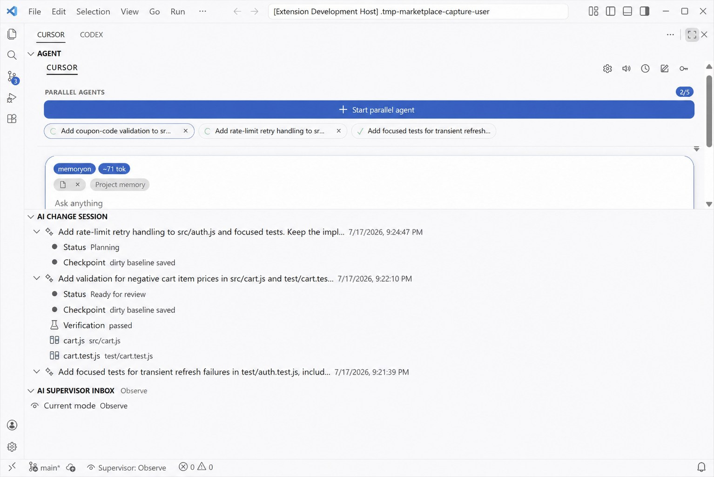
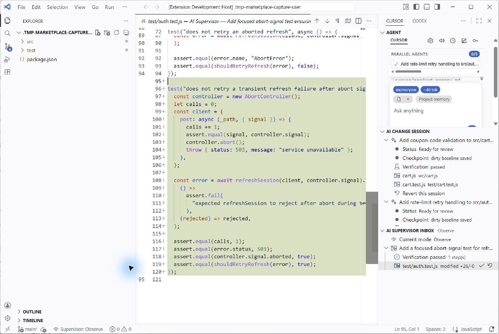
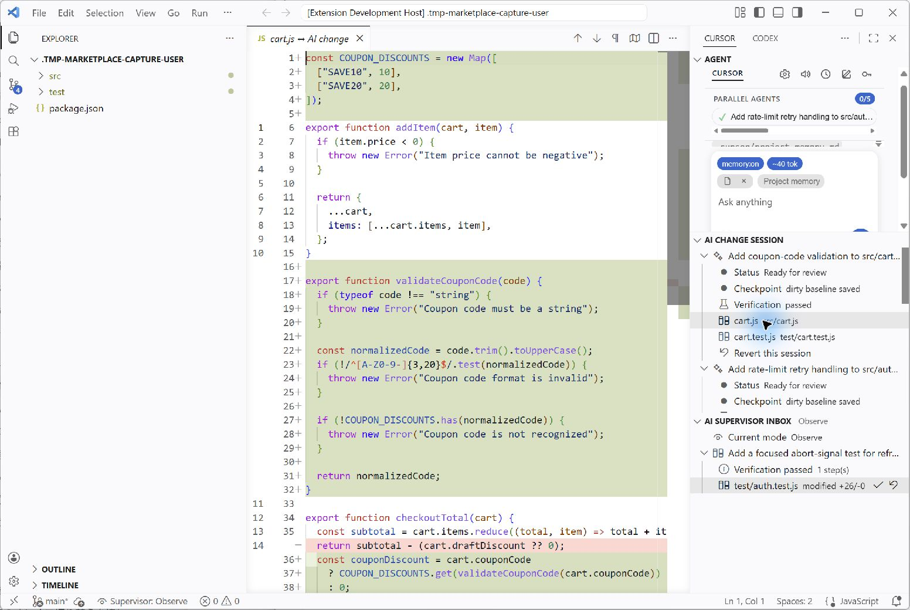

# Cursor Subscription for VS Code

**Unofficial** community extension. Not affiliated with Anysphere / Cursor.

Run [Cursor](https://cursor.com) agents from the VS Code sidebar with your Cursor user API key and plan. Built on the public [Cursor TypeScript SDK](https://cursor.com/docs/sdk/typescript) (beta).

日本語は下の [日本語](#日本語) を参照してください。

## See it in action

### Run independent agents in parallel

Start another conversation while the current agent keeps working, then switch between live runs from the parallel-agent bar.

### Let Supervisor work in isolation, then review the diff

Supervisor runs in a detached Git worktree and returns per-file diffs, reasons, and apply/discard controls.

### Restore checkpoints without losing a dirty baseline

Change sessions distinguish your pre-existing uncommitted work from AI edits, so restore removes only the agent's changes.

## Features

- Local Cursor Agent for the current workspace
- Multi-turn chat with streaming Markdown
- Model picker (search, thinking / context / effort; default Auto)
- Profiles: Agent, Plan, Multitask (SDK subagents)
- Image context (PNG, JPEG, GIF, WebP)
- Project Skills, `.cursor/mcp.json` MCP servers, and a **Rules / Skills / MCP** Workspace group to enable or disable each item
- Project rules (`.cursor/rules.md`) and project memory (`.cursor/project-memory.md`)
- Permission modes (Windows Safe worktree / auto-review / full access)
- `@` file search, drag-and-drop (hold Shift while dragging) / paste file references
- Active editor and selection context
- Conversation history across restarts
- Commit message generation from Source Control
- Autopilot change sessions with post-run file approval, verification, and review
- AI Supervisor inbox with Off, Observe, and Autonomous modes, including TODO(ai) save triggers, failed-test triggers, task priority, and an optional AI review gate
- Concurrent normal-chat agents across separate conversations
- Isolated Git worktree execution with conflict-safe, per-file apply/discard
- Multi-root workspace support for chat cwd, file search, Skills, MCP, and commands (footer can pick and pin a folder per chat)
- Preview-and-accept inline code generation instead of immediate edits
- AI Quick Fix actions for editor diagnostics
- Automatic validation with optional bounded self-repair
- AI review findings published into the Problems panel
- AI change-session history and revertible checkpoints, including dirty Git baselines
- Project memory, debug-context analysis, and production-ready opt-in inline completions
- Japanese / English UI (follows VS Code display language)
- Token usage dashboard, conversation search / pin / export
- Find in chat (Ctrl/Cmd+F) with match highlighting and prev/next navigation
- Cursor-style slash templates from `.cursor/commands` and `~/.cursor/commands`, plus `/agent`, `/plan`, `/multitask`, `/compare` best-of-N with isolated verification and auto-winner selection, and `/orchestrate` with result-aware synthesis
- **Cursor: Run Task Pipeline** (GitHub Issue / `TODO(ai)` / free text → Autopilot → verify → optional PR)
- Branch + PR creation via GitHub CLI after verified edits
- Detached background agents that continue after VS Code closes and return isolated changes for review
- Interactive audit timeline with optional team-shared JSONL logging and **Cursor: Export AI Audit Log**
- Workspace Trust limits on autonomous Supervisor, auto-repair, keep-all review, and background agents

## Sidebar views

Activity Bar **Cursor** container:

- **Agent** — chat, models, profiles, usage, and parallel agents
- **Workspace** — one tree with groups for Sessions, Inbox, Rules / Skills / MCP, Background, and Audit (Keep/Restore, Supervisor apply/discard, integration toggles, detached workers, and the audit timeline)

## Slash commands

Type `/` in the chat composer:

- `/agent`, `/plan`, `/multitask` — switch the run profile for the next send
- `/compare` — best-of-N parallel candidates in isolated worktrees; each candidate is verified in isolation, a winner is auto-selected when all finish (or pick one manually), then apply only the winner (or create a PR)
- `/orchestrate` — plan the work, fan out parallel subtasks, then synthesize a final answer from each subtask's summary and changed files; when started from a normal chat with history, `cursorSubscription.orchestrateHandoffConversation` (default on) passes a truncated transcript to planning only so the planner can embed needed context into each subtask; the home view shows phase, each agent with open/status controls, and live tool/file activity for every stage; the detail view shows Plan → parallel subtasks → Synthesis as a visual flow
- Project and user templates from `.cursor/commands/*.md` and `~/.cursor/commands/*.md`

## AI-native workflow

### Parallel chat agents

Each conversation owns an independent Cursor agent and run. Start a task, click the prominent **Start parallel agent** button in the parallel-agent bar, and send another task to run both at the same time. The button is disabled with a limit indicator when every parallel slot is occupied. The bar lists running and queued conversations, switches to any task with one click, and stops only the selected agent. Completed, failed, and stopped parallel tasks remain as review-pending chips until you open that conversation and then leave it. Returning to history also shows **Running** or **Queued** badges and restores live output. Messages inside one conversation still run in order, but queued follow-ups can be selected and launched as additional parallel agents (subject to the same slot limit). Configure `cursorSubscription.maxParallelChatAgents` (default: 3, maximum: 8) to set the limit. Concurrent calls may consume Cursor plan quota simultaneously. Explicitly attached target files are owned by one run at a time; conflicting runs are moved to isolated worktrees. Completed isolated edits pass through a FIFO apply queue and reacquire ownership for their actual changed files. Parallel edits to the same file use a three-way merge when their changed hunks do not overlap. For overlapping text edits, a confirmation dialog can send the conflict back to AI to infer both sides' intent and resolve it; the result is applied only after marker and concurrent-change safety checks.

### AI Supervisor

The **AI Supervisor Inbox** turns saved editor errors and manually entered goals into durable tasks. Modes are **Off** (no detection or automatic runs), **Observe** (detect and queue only; detection itself does not use Cursor plan quota), and **Autonomous** (start queued tasks after a configurable debounce with hourly run, execution-time, file-count, and changed-line budgets). Enable `cursorSubscription.supervisorTodoTrigger` to create tasks when you save a file that contains `TODO(ai):` comments, or `cursorSubscription.supervisorTestFailureTrigger` when failed test-like VS Code tasks complete. Manual and detected tasks can carry high / normal / low priority. Optional `cursorSubscription.supervisorReviewGate` asks a second AI pass to approve or reject the change set before review or auto-apply.

Each Supervisor task runs with its own agent in a detached Git worktree. The normal chat has a separate agent and remains usable while Supervisor is working. The extension overlays the current non-excluded working state without committing it, stores only the dirty-file baseline in private extension storage, and runs the Supervisor away from the active editor. Results stay in the inbox until you apply all, apply individual files, or discard them. Every proposed file records why it changed; the reason appears in the inbox tooltip and above the proposed side of the diff. A file is not applied if the original workspace copy changed while AI was running. Sensitive and lock-file globs are excluded by default. Verified documentation and test-only changes can optionally be auto-applied, but this is disabled by default.

The current mode is always shown in the Supervisor inbox header, the first inbox row, and the status bar. Click the mode row or status-bar control, or run **Cursor: Choose AI Supervisor Mode**, to switch modes. Autonomous agent calls consume Cursor plan quota; if chat and Supervisor run together, both calls may consume quota concurrently. Local diagnostics, Git comparisons, and verification commands do not.

Manual Supervisor tasks can depend on earlier tasks. Autonomous mode runs up to `cursorSubscription.supervisorMaxParallelTasks` independent tasks in separate worktrees, reserves discovered file ownership, and queues automatic apply until overlapping owners finish. Run **Cursor: Scan GitHub CI and PR Feedback**, or enable `cursorSubscription.supervisorGitHubTrigger`, to create tasks from failed checks, requested-change reviews, inline review comments, and explicitly marked `/cursor`, `[cursor]`, or `TODO(ai)` PR comments through `gh`. Use **Cursor: Scan TODO(ai) Comments** or **Cursor: Scan Diagnostics for AI Tasks** to queue workspace findings on demand.

Run **Cursor: Run Autopilot Change** to give Cursor an outcome instead of an individual edit. After the agent finishes editing, review each file diff and choose whether to keep or restore it. Automatic verification waits until every proposed file has been decided. The **Sessions** group in the Workspace tree keeps the latest 20 sessions with edited files, decisions, verification results, and revert actions.

Run **Cursor: Run Task Pipeline** to drive a GitHub Issue, workspace `TODO(ai)` comment, or free-text goal through Autopilot, verification, and an optional pull request. `cursorSubscription.pipelineAutoKeep` can keep edits without the Keep/Restore modal and create a PR automatically after verification.

At session start, the extension stores a private workspace checkpoint. This protects pre-existing uncommitted files as well as clean Git baselines, so an individual AI edit or the full session can be restored without discarding earlier work. After changes are accepted, the extension detects `validate`, `compile`, `lint`, or `test` npm scripts and runs the best available verification automatically. Configure `cursorSubscription.verificationCommands` to override detection. Automatic repair is available through `cursorSubscription.autoRepair` and is disabled by default because it can consume additional plan quota.

Verification appears as build/lint/test/E2E gates under the Workspace Sessions and Inbox groups. Sessions also show the persisted automatic-repair budget and whether repair is active, successful, or exhausted. When `cursorSubscription.autoRepair` is enabled, repair prompts stay scoped to the failing command output and the files already edited in the session. Sessions can be compared with the previous session at both the file-set and saved-content levels, and `cursorSubscription.changeSessionReviewPolicy` can prompt, keep all, or safely restore all pending edits. Plan-profile responses include an executable step artifact; **Cursor: Execute Last Plan with Checkpoints** runs those steps sequentially with a new change-session checkpoint for each. `/compare` keeps every candidate in its own worktree, verifies each candidate there, and with `cursorSubscription.bestOfNAutoSelect` (default on) picks a winner from verification and change-quality signals when all runs finish; tied scores can call an optional short AI judge via `cursorSubscription.bestOfNAutoJudge` (default off; uses extra plan quota). Auto-select only chooses candidates that produced isolated change artifacts. Apply only the selected winner, with an **Apply and create PR** action. `/orchestrate` plans the work, runs independent subtasks in parallel, then synthesizes a final answer from each subtask's captured summary and changed files, with live tool/file activity on each stage. With `cursorSubscription.orchestrateHandoffConversation` (default on), a truncated prior chat transcript is included in the planning prompt only; subtasks and synthesis still do not receive the original conversation.

Use **Cursor: Start Background Agent** for long tasks. A detached local worker continues if the VS Code window or extension host closes, writes its durable status into extension-private storage, and restores the job under the **Background** group in the Workspace tree after restart. Its edits stay in a dedicated Git worktree until you apply or discard them. API-key material is passed to the worker only through its standard input and is not written into the job file.

The **Audit** group in the Workspace tree makes apply, restore, PR, and plan actions inspectable without exporting Markdown. Enable `cursorSubscription.auditSharedLogEnabled` to append JSONL events to `.cursor/ai-audit-log.jsonl` (or another safe workspace-relative path) for team review. Run **Cursor: Export AI Audit Log** to export the current audit history.

The **Rules / Skills / MCP** group lists project rules, Skills, MCP servers, and slash-command templates so you can open or enable/disable each item without editing JSON by hand.

Usage guardrails support daily and monthly token limits plus an estimated monthly USD limit. `cursorSubscription.dailyTokenBudget` warns near 80% and confirms before new runs at 100% (0 disables the budget). Cost estimates use only the blended rate you provide in `cursorSubscription.estimatedCostPerMillionTokensUsd`; they are an approximation, not billing data.

Additional commands:

- **Cursor: Review Workspace Changes** publishes line-level findings to VS Code Problems.
- **Cursor: Analyze Debug Context** sends the active editor, diagnostics, breakpoints, and debug-session metadata to the agent.
- **Cursor: Refresh Project Memory** creates or updates `.cursor/project-memory.md`.
- AI Quick Fix actions appear alongside diagnostics in the editor.
- Opt-in inline completions can be enabled with `cursorSubscription.enableInlineCompletions`. They include configurable debounce and output limits, LRU caching, in-flight request deduplication, project-rule context, token/cost guards, and acceptance-rate reporting in Usage.

Open **Cursor: Open AI Feature Settings** or use the gear button in the chat header to enable or disable these features. `cursorSubscription.enableAiNativeFeatures` is the master switch; core chat remains available when it is off. Each AI-native feature can also be controlled individually.

## Windows safety

Cursor's local SDK sandbox is unavailable on Windows. The extension therefore defaults Windows to **Safe worktree** mode and performs a one-time migration of previously saved permission modes: Auto-review remains enabled, normal agent edits run in a detached Git worktree, and completed changes are applied only with conflict checks. A first-run modal discloses the limitation. Safe worktree mode keeps a compact status indicator; direct-workspace **Auto-review** and **Full access** require explicit confirmation and show a non-dismissible warning banner. Safe worktree mode reduces accidental workspace edits, but it is not an OS security boundary: tools can still access the host filesystem and network.

Safe worktree mode requires the workspace to be a Git repository. Plan mode is read-only and does not create a worktree.

## Data and privacy

- Prompts and the context you explicitly include—such as selected code, referenced files, images, diagnostics, debug metadata, project memory, Skills, and MCP results—are sent to Cursor through the public Cursor SDK under your account and plan. Agent tools may read additional workspace files when needed for the task.
- The Cursor API key is stored in VS Code SecretStorage. This extension does not read the Cursor desktop login session and does not add its own telemetry or analytics.
- Conversation transcripts and aggregate token usage are stored in VS Code workspace state. Copies of external attachments, dirty-file checkpoints, isolated-run baselines, and Supervisor task data are stored in VS Code extension-private storage. Deleting a conversation removes its transcript and managed external-attachment copies; change-session history and checkpoint data are limited to the latest 20 sessions, while Supervisor data remains until its task is dismissed or extension storage is removed.
- Project MCP servers, detached background agents, and configured pre-edit, post-edit, and verification commands run locally with the permissions of the VS Code extension host or spawned process. In an untrusted (Restricted) workspace, autonomous Supervisor execution, auto-repair, keep-all review policy, and background agents stay limited until you trust the folder.
- Uninstalling the extension does not guarantee immediate deletion of VS Code extension storage. Use VS Code's profile/application-data controls when you need to remove all retained local data.

## Requirements

- VS Code 1.100 or later
- Node.js 22.13 or later (local agent runtime used by the SDK)
- A Cursor account and [user API key](https://cursor.com/dashboard)
- A Git repository for Safe worktree mode, Supervisor, background agents, checkpoints, and PR / Task Pipeline flows
- The built-in VS Code Git extension (`vscode.git`)
- Authenticated [GitHub CLI](https://cli.github.com/) (`gh`) for PR creation, Task Pipeline, and Supervisor GitHub scans
- A trusted workspace when you want autonomous Supervisor, auto-repair, keep-all review, or background agents

Usage follows **your** Cursor plan. This extension does not read the Cursor desktop app login session.

## Getting started

1. Install this extension from the Marketplace (`ark4ez.cursor-subscription-for-vscode`).
2. Open the **Cursor** view in the Activity Bar (start with **Agent**).
3. Run **Cursor: Set API Key** and paste your key from the [Cursor Dashboard](https://cursor.com/dashboard).
4. If VS Code opened the folder as Restricted, trust the workspace when you intend to use autonomous automation.
5. Confirm the workspace is a Git repository for worktree-based safety features; optionally run `gh auth login` for PR and GitHub Supervisor triggers.
6. Pick a permission mode in the chat footer (Windows defaults to Safe worktree).

The API key is stored in VS Code SecretStorage (not in settings or the workspace). Search settings for `cursorSubscription`, or open **Cursor: Open AI Feature Settings**, for feature toggles.

## Notes

- The Cursor SDK is in public beta; APIs may change.
- **Interrupt (`Ctrl+Enter`):** There is no public SDK API to steer a running prompt in place. This extension cancels the current run and sends a priority follow-up on the same conversation.

## Links

- [Source code](https://github.com/ark4ez/cursor-agent-vscode-extension)
- [Issues](https://github.com/ark4ez/cursor-agent-vscode-extension/issues)
- [Changelog](https://github.com/ark4ez/cursor-agent-vscode-extension/blob/master/CHANGELOG.md)
- [License (MIT)](https://github.com/ark4ez/cursor-agent-vscode-extension/blob/master/LICENSE)

---

## 日本語
Anysphere / Cursor 非提携の**非公式**拡張機能です。公式 TypeScript SDK（公開ベータ）を使い、VS Code のサイドバーから Cursor Agent を実行します。

上の画面例では、並列 Agent の実行、Supervisor の分離実行から差分適用まで、未コミットの作業を保護したチェックポイント復元を確認できます。

### できること

- ワークスペース対象のローカル Cursor Agent
- 連続チャットとストリーミング Markdown
- モデル選択（検索、Thinking / Context / Effort、既定は Auto）
- 実行プロファイル: Agent / Plan / Multitask
- 画像コンテキスト、Skills、`.cursor/mcp.json` の MCP、およびワークスペースツリーの **Rules / Skills / MCP** グループでの個別の有効/無効
- プロジェクトルール（`.cursor/rules.md`）とプロジェクトメモリ（`.cursor/project-memory.md`）
- 実行権限モード（Windows安全worktree / 自動レビュー / フルアクセス）
- `@` ファイル参照、D&D / 貼り付け、選択範囲の添付
- 会話履歴の復元、コミットメッセージ生成
- ファイルごとの変更確認、検証、レビューを通して実行する Autopilot 変更セッション
- Off / 監視 / 自律実行を切り替えられる AI Supervisor 受信箱（`TODO(ai)` 保存トリガー、テスト失敗トリガー、優先度、任意の AI レビューゲート）
- 別々の会話で通常チャットAgentを並列実行
- 隔離Git worktreeでの実行と、競合を防ぐファイル単位の適用・破棄
- マルチルートワークスペース対応（cwd、ファイル検索、Skills、MCP、コマンド）
- 適用前に確認できるインライン生成コードの差分プレビュー
- Problems の診断に対する AI Quick Fix と、行単位の AI コードレビュー
- 編集後の自動検証と、回数制限付きの自動修正
- 未コミット変更も保護するAI変更セッション履歴とチェックポイント
- プロジェクト記憶、デバッグ状況の解析、実用向けのオプトイン・インライン補完
- VS Code の表示言語に連動した日英 UI
- トークン使用量、会話検索 / ピン留め / 書き出し
- 会話内テキスト検索（Ctrl/Cmd+F、ハイライトと前後移動）
- `.cursor/commands` と `~/.cursor/commands` のスラッシュテンプレート、および `/agent`・`/plan`・`/multitask`・隔離検証と勝者自動選択付き `/compare`・結果反映合成の `/orchestrate`
- **Cursor: タスクパイプラインを実行**（GitHub Issue / `TODO(ai)` / 自由文 → Autopilot → 検証 → 任意で PR）
- 検証後の GitHub CLI によるブランチと PR 作成
- VS Code 終了後も継続し、隔離された変更をレビューに戻すバックグラウンド Agent
- 対話的な AI 監査タイムライン、共有 JSONL ログ、**Cursor: AI監査ログをエクスポート**
- Workspace Trust による自律 Supervisor・自動修復・すべて保持・バックグラウンド Agent の制限

### サイドバービュー

Activity Bar の **Cursor** コンテナ:

- **エージェント** — チャット、モデル、プロファイル、使用量、並列 Agent
- **ワークスペース** — Sessions / Inbox / Rules / Skills / MCP / Background / Audit をまとめた1本のツリー（保持/復元、Supervisor の適用・破棄、統合の有効/無効、分離ワーカー、監査タイムライン）

### スラッシュコマンド

チャット入力で `/` を入力:

- `/agent`、`/plan`、`/multitask` — 次の送信の実行プロファイルを切り替え
- `/compare` — 隔離 worktree での best-of-N。各候補を隔離検証し、全完了後に勝者を自動選択（手動選択も可）。勝者だけを適用（または PR 作成）
- `/orchestrate` — 計画 → 並列サブタスク → 各サブタスクの要約と変更ファイルを踏まえた最終回答の合成。履歴のある通常チャットから開始した場合、`cursorSubscription.orchestrateHandoffConversation`（既定オン）が切り詰めた会話履歴を計画プロンプトだけへ渡し、プランナーが各サブタスクへ必要な文脈を埋め込めるようにします。ホームにフェーズ、各エージェントの状態・開く操作、ステージごとのライブなツール/ファイル作業箇所を表示。詳細ビューでは Plan → 並列サブタスク → Synthesis を視覚的なフローとして表示します
- `.cursor/commands/*.md` と `~/.cursor/commands/*.md` のテンプレート

### AIネイティブ機能

通常チャットは会話ごとに独立したCursor AgentとRunを持ちます。処理中に **並列Agent** バーの目立つ **並列Agentを起動** ボタンを押して別の指示を送ると、両方を同時実行できます。上限到達時はボタンが無効になり、現在数と上限を確認できます。バーには実行中・待機中の会話が常時表示され、クリックで即座に切り替え、×ボタンでそのAgentだけを停止できます。並列タスクが完了・失敗・停止した場合は「確認待ち」として残り、その会話を一度開いて別の会話または画面へ移動した時点で消えます。履歴にも **実行中** または **待機中** と表示され、会話へ戻ると途中の出力も復元されます。同一会話内のメッセージは従来どおり順番に処理しますが、送信待ちキューから選択して別Agentとして並列起動することもできます（同じ並列上限が適用されます）。同時数は `cursorSubscription.maxParallelChatAgents`（初期値3、最大8）で設定できます。同時呼び出しはCursorの利用枠を並行して消費する場合があります。同じファイルへの並行編集も、変更箇所が重ならなければ3-wayマージで自動統合します。テキスト変更が重なった場合は確認ダイアログからAIへ戻し、双方の意図を推測して解決できます。競合マーカーの除去と解決中の再変更を確認できたファイルだけを適用します。

**AI Supervisor受信箱**は、保存時のエラーと手動で追加した目標をタスクとして管理します。モードは **Off**（検出も自動実行もしない）、**監視**（検出と受信箱への追加のみ。検出自体はCursorの利用枠を消費しません）、**自律実行**（設定した待機時間後に、1時間あたりのAI実行数・実行時間・変更ファイル数・変更行数の上限内でタスクを自動実行）です。`cursorSubscription.supervisorTodoTrigger` を有効にすると、`TODO(ai):` を含むファイル保存時にタスクを作成できます。`cursorSubscription.supervisorTestFailureTrigger` では失敗したテスト系 VS Code タスクからタスクを作成できます。手動・検出タスクには高 / 通常 / 低の優先度を付けられます。任意の `cursorSubscription.supervisorReviewGate` では、レビューまたは自動適用の前に2回目のAI判定で変更セットの承認/却下を求めます。

各タスクは専用エージェントを使い、通常の作業ツリーとは別のGit worktreeで実行されます。通常チャットも別のエージェントを持つため、Supervisorの実行中でも利用できます。現在の未コミット状態はGitへコミットせずに隔離環境へ反映し、AI実行前の差分だけを拡張機能専用ストレージへ退避します。結果は受信箱でファイルごと、または一括で適用・破棄できます。変更理由はファイルごとに保存され、受信箱のホバーと差分右ペインの先頭に表示されます。AI実行中に元ファイルが変更された場合、その変更は自動適用しません。秘密情報とロックファイルは初期状態で除外されます。

現在のモードはSupervisor受信箱の見出し、受信箱の先頭行、ステータスバーへ常時表示されます。モード行またはステータスバーをクリックするか、**Cursor: AI Supervisorモードを選択** で切り替えられます。自律実行のAI呼び出しはCursorの利用枠を使い、チャットとSupervisorを同時実行すると両方の呼び出しが並行して利用枠を消費する場合があります。診断検出、Git比較、検証コマンドはローカル処理です。

手動Supervisorタスクには先行タスクへの依存関係を設定できます。自律実行では、独立したタスクを `cursorSubscription.supervisorMaxParallelTasks` の上限まで別々のworktreeで並列実行し、検出したファイル所有権が重なる場合は先行タスクの完了まで自動適用を待機します。**Cursor: GitHub CIとPRフィードバックを検出**を実行するか `cursorSubscription.supervisorGitHubTrigger` を有効にすると、`gh` 経由でCI失敗、変更要求レビュー、インラインレビューコメント、明示的な `/cursor`・`[cursor]`・`TODO(ai)` コメントをタスク化できます。**Cursor: TODO(ai)コメントを検出** または **Cursor: 診断からAIタスクを検出** で、ワークスペース内の候補を手動でキューに追加できます。

**Cursor: Autopilot変更を実行**では、個別の編集内容ではなく達成したい結果を指示できます。エージェントの編集後、ファイルごとの差分を確認して保持または復元できます。すべてのファイルを確定するまで自動検証は保留されます。ワークスペースツリーの **Sessions** グループには直近20件の履歴、編集ファイル、判断結果、検証結果が表示されます。

**Cursor: タスクパイプラインを実行**では、GitHub Issue、ワークスペースの `TODO(ai)`、または自由文の目標を Autopilot → 検証 → 任意の PR まで一気に進められます。`cursorSubscription.pipelineAutoKeep` を有効にすると、保持/復元モーダルなしで変更を確定し、検証後に自動で PR を作成できます。

セッション開始時にワークスペース専用のチェックポイントを保存するため、開始前から未コミットだったファイルも保護したまま、個別のAI編集またはセッション全体を復元できます。変更確定後、検証コマンドを npm の `validate`、`compile`、`lint`、`test` から自動検出します。`cursorSubscription.verificationCommands` で上書きできます。検証失敗時の自動修正は追加の利用枠を消費する場合があるため、初期状態では無効です。

検証結果は変更セッションと Supervisor の Inbox で build / lint / test / E2E のゲートとして表示されます。`cursorSubscription.autoRepair` を有効にすると、修復プロンプトは失敗した検証出力とセッション内の編集済みファイルに絞られます。変更セッションは直前のセッションと比較でき、`cursorSubscription.changeSessionReviewPolicy` でファイルごとの確認、すべて保持、安全なすべて復元を選べます。Planプロファイルの応答は実行可能なステップ成果物を含み、**Cursor: チェックポイント付きで直前のPlanを実行**から各ステップ前に別々の変更セッション・チェックポイントを作りながら順番に実行できます。`/compare` の各候補は別worktreeに保持され、そこで検証されます。`cursorSubscription.bestOfNAutoSelect`（既定オン）では全候補完了後に検証と変更品質シグナルから勝者を自動選択し、同点時は `cursorSubscription.bestOfNAutoJudge`（既定オフ・追加の利用枠を消費）で短いAI判定をオプトインできます。自動選択は変更成果物がある候補のみを対象にします。選択した勝者だけを適用またはPR化します。`/orchestrate` は計画のあと独立したサブタスクを並列実行し、各サブタスクの要約と変更ファイルを踏まえて最終回答を合成します。`cursorSubscription.orchestrateHandoffConversation`（既定オン）では、切り詰めた元チャット履歴を計画プロンプトだけへ渡します（サブタスクと合成には元会話は渡りません）。各ステージでは作業中のツール/ファイルがライブ表示されます。

通常の並列チャットでは対象ファイルの所有権を予約し、競合する実行を隔離worktreeへ移します。完了した変更はFIFO適用キューを通り、実際の変更ファイルの所有権を取得してから安全にマージされます。**Cursor: バックグラウンドAgentを開始**では、VS Code終了後も継続する分離ワーカーへ長時間タスクを渡せます。結果は再起動後に復元され、ワークスペースツリーの **Background** グループから適用・中止・破棄できます。

変更セッションには修復バジェットの状態と、セッション間の実ファイル内容差分が表示されます。ワークスペースツリーの **Audit** グループでは操作履歴を対話的に確認でき、`cursorSubscription.auditSharedLogEnabled` を有効にするとチーム向けJSONLログも残せます。**Cursor: AI監査ログをエクスポート** で現在の監査履歴を書き出せます。**Rules / Skills / MCP** グループでは、プロジェクトルール、Skills、MCP、スラッシュコマンドを一覧し、JSONを手編集せずに開く・有効/無効を切り替えられます。インライン補完はデバウンス、重複排除、LRU、予算ガード、プロジェクトルール、採用率表示に対応しています。

使用量ガードには日次・月次トークン上限と推定月間USD上限があります。`cursorSubscription.dailyTokenBudget` は約80%で警告し、100%では新規実行前に確認します（0で無効）。コスト推定は `cursorSubscription.estimatedCostPerMillionTokensUsd` にユーザーが設定した概算単価だけを使い、実際の請求額ではありません。

チャット上部の歯車ボタン、または **Cursor: AI機能の設定を開く** から機能別にオン・オフできます。マスタースイッチを無効にしても基本チャットは引き続き利用できます。

### Windowsでの安全性

WindowsではCursorローカルSDKのサンドボックスを利用できません。そのため、この拡張機能はWindowsで**安全worktree**を既定にし、以前保存された実行権限もアップデート後の初回起動時に一度だけ安全worktreeへ移行します。自動レビューを維持したまま通常のAgent編集を分離Git worktreeで実行し、完了した変更は競合確認後に適用します。初回警告への確認が必要です。安全worktree中は小さな状態表示だけを残し、ワークスペース直接実行またはフルアクセス中は閉じられない警告バナーを表示します。

安全worktreeはワークスペースへの意図しない編集を抑えますが、OSのセキュリティ境界ではありません。ツールはホストのファイルシステムとネットワークへアクセスできます。ワークスペース直接実行の**自動レビュー**または**フルアクセス**へ切り替える際は、明示確認が必要です。安全worktreeにはGitリポジトリが必要です。読み取り専用のPlanモードではworktreeを作成しません。

### データとプライバシー

- プロンプト、および選択コード、参照ファイル、画像、診断、デバッグ情報、プロジェクトメモリ、Skills、MCP結果など明示的に含めたコンテキストは、ご自身のアカウントとプランで公開Cursor SDKを通じてCursorへ送信されます。タスクの実行に必要な場合、Agentツールが追加のワークスペースファイルを読み取ることがあります。
- Cursor APIキーは VS Code SecretStorageへ保存します。この拡張機能はCursorデスクトップのログイン情報を読み取らず、独自のテレメトリやアクセス解析も追加しません。
- 会話本文と集計トークン使用量は VS Codeのworkspace stateへ保存します。外部添付ファイルのコピー、未コミットファイルのチェックポイント、隔離実行のbaseline、Supervisorタスク情報は VS Codeの拡張機能専用ストレージへ保存します。会話を削除すると本文と管理対象の外部添付コピーを削除します。変更セッションとチェックポイントは最新20件に制限され、Supervisorデータはタスクを破棄するか拡張機能ストレージを削除するまで残ります。
- プロジェクトMCPサーバー、バックグラウンドAgent、および設定した編集前・編集後・検証コマンドは、VS Code拡張ホストまたは起動したプロセスの権限でローカル実行されます。信頼されていない（Restricted）ワークスペースでは、自律 Supervisor、自動修復、すべて保持ポリシー、バックグラウンド Agent は、フォルダを信頼するまで制限されます。
- 拡張機能をアンインストールしても、VS Codeの拡張機能ストレージが即時削除されるとは限りません。ローカル保存データをすべて削除する必要がある場合は、VS Codeのプロファイルまたはアプリケーションデータ管理を使用してください。

### 必要なもの

- VS Code 1.100 以降
- Node.js 22.13 以降
- [Cursor Dashboard](https://cursor.com/dashboard) のユーザー API キー
- 安全worktree、Supervisor、バックグラウンドAgent、チェックポイント、PR / タスクパイプライン向けの Git リポジトリ
- 組み込みの VS Code Git 拡張機能（`vscode.git`）
- PR 作成、タスクパイプライン、Supervisor の GitHub 検出向けの認証済み [GitHub CLI](https://cli.github.com/)（`gh`）
- 自律 Supervisor・自動修復・すべて保持・バックグラウンド Agent を使う場合は信頼済みワークスペース

課金・利用枠はご自身の Cursor プランに従います。Cursor アプリのログインは使いません。

### 使い方

1. Marketplace からインストール（`ark4ez.cursor-subscription-for-vscode`）
2. Activity Bar の **Cursor** を開く（最初は **エージェント**）
3. **Cursor: APIキーを設定** でキーを入力（SecretStorage に保存）
4. Restricted で開いている場合、自律自動化を使うならワークスペースを信頼する
5. worktree 系の安全機能のため Git リポジトリであることを確認し、必要なら `gh auth login` を実行
6. チャットフッタで実行権限モードを選ぶ（Windows の既定は安全worktree）

設定は `cursorSubscription` で検索するか、**Cursor: AI機能の設定を開く** から変更できます。
